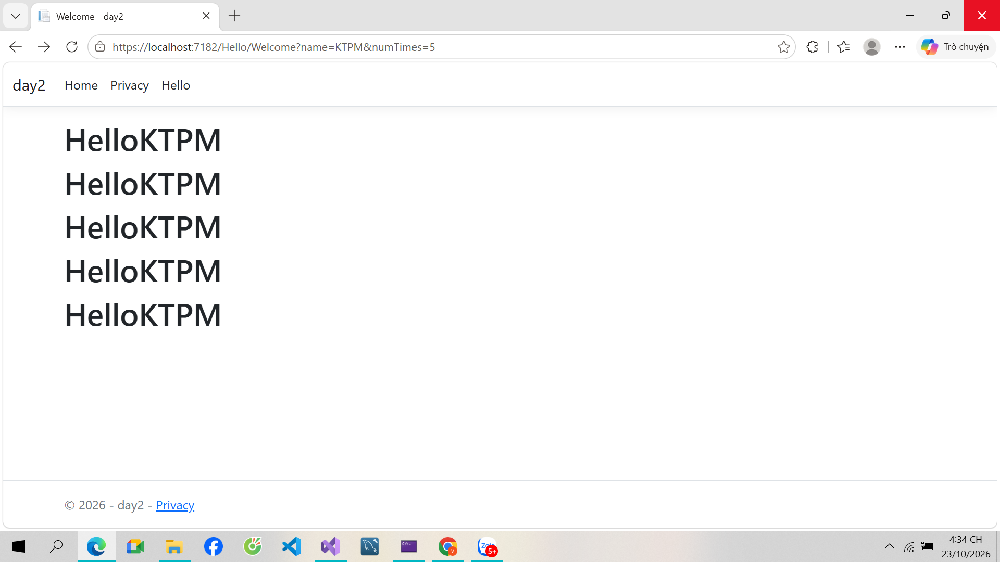

# day2 - ASP.NET Core MVC

Bài thực hành day2: ASP.NET Core MVC (.NET 8) với `HelloController`.

## Chạy

Mở `day2daovanbach.sln` bằng Visual Studio 2022 rồi nhấn F5, hoặc:

```bash
dotnet run
```

Truy cập: `https://localhost:7182/Hello/Welcome?name=KTPM&numTimes=5`

## Giao diện khi chạy


